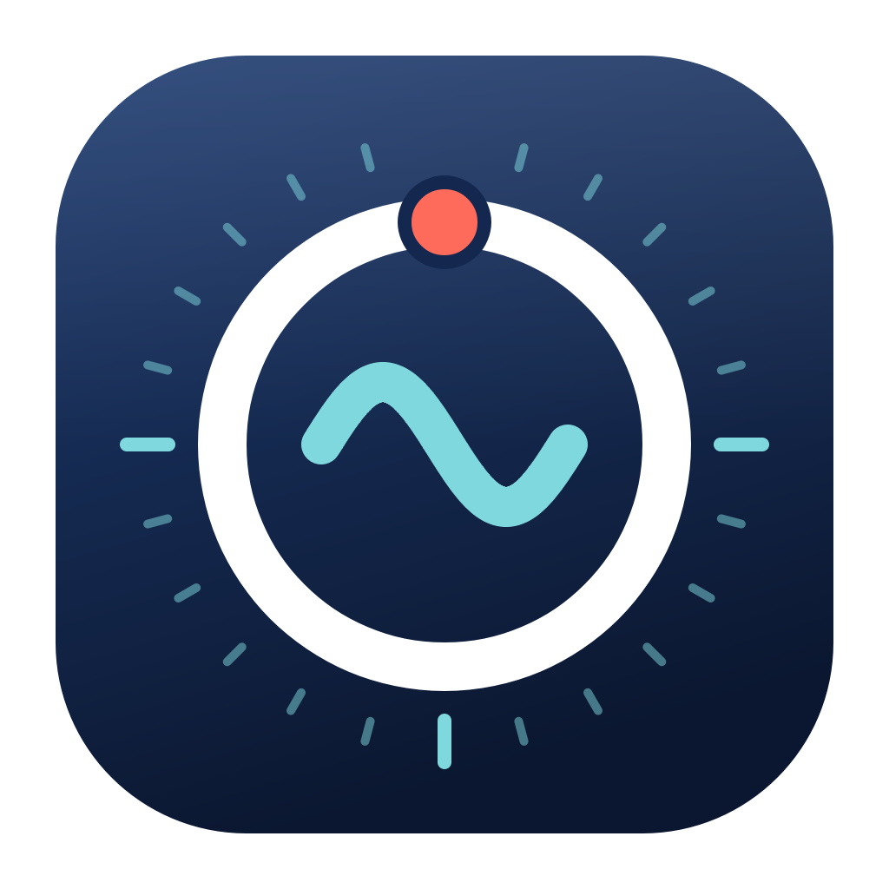
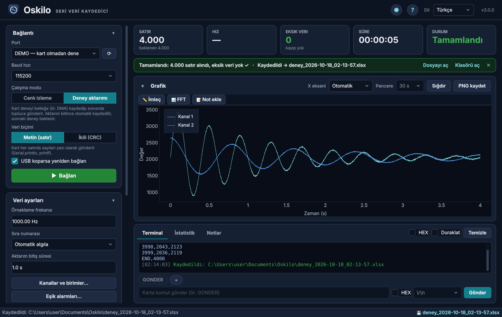
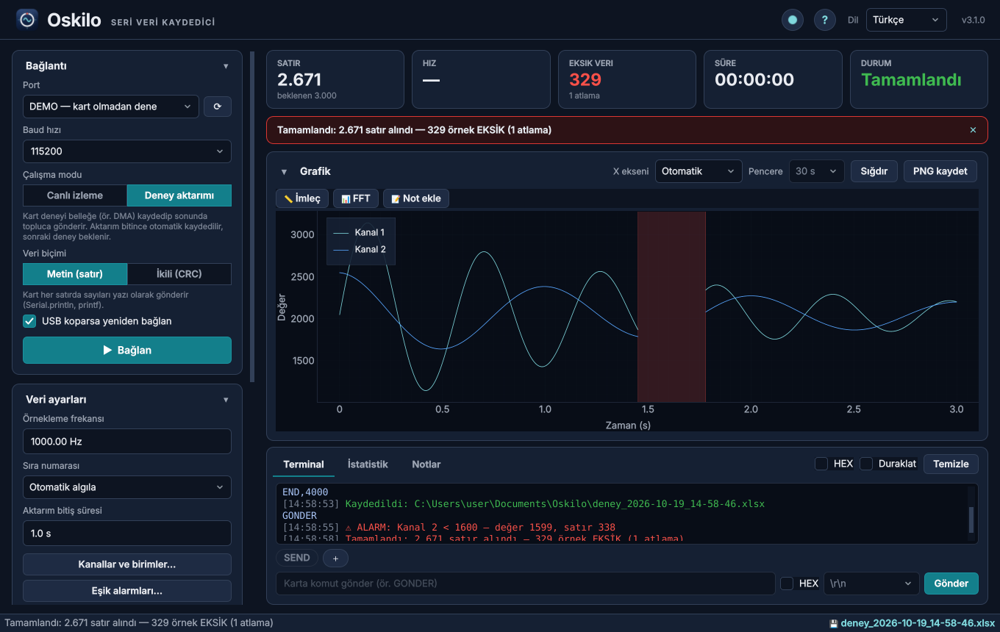
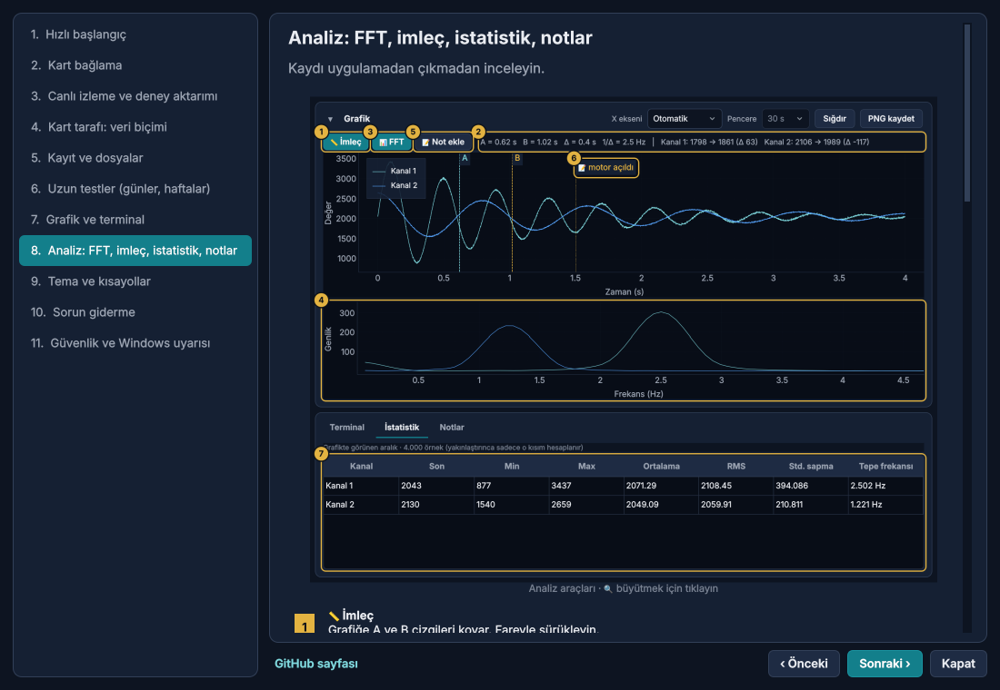

<p align="center">
  
</p>

<h1 align="center">Oskilo</h1>

<p align="center">
  <a href="README.md">🇬🇧 English</a> · <b>🇹🇷 Türkçe</b>
</p>

<p align="center">
  <b>STM32, Arduino, ESP32</b> ve seri porttan veri gönderen her kart için kayıpsız veri kaydedici.<br>
  Canlı grafik, kayıp veri tespiti, FFT, eşik alarmları ve tek tıkla <b>Excel / CSV / TXT</b> çıktısı.<br>
  <sub>Eski adı: <i>Data Logger</i> (v2.x)</sub>
</p>

<p align="center">
  <a href="https://github.com/mhmtcndsgn/Oskilo/releases/latest/download/Oskilo_Windows.zip"></a>
  <a href="https://github.com/mhmtcndsgn/Oskilo/releases/latest/download/Oskilo_macOS.dmg"></a>
  <br>
  <a href="https://github.com/mhmtcndsgn/Oskilo/releases/latest"></a>
  
</p>



---

## ✨ Özellikler

- **Sıfır veri kaybı.** Okuma ayrı bir thread'de çalışır, diske ya da ekrana hiç beklemez. Bu yüzden yüksek hızlı toplu gönderimler de (örneğin 921600 baud'da gönderilen bir DMA tamponu) eksiksiz gelir. 300.000 satırlık tek parça aktarımla, saniyede yaklaşık 125.000 satır hızında test edildi.
- **Kayıp tespiti.** Kart sıra numarası ve `START,N` / `END,N` gönderirse kaybolan her satır sayılır ve grafikte kırmızıyla gösterilir.
- **İkili (CRC) veri biçimi:** metne göre 2–4 kat az bayt; kabloda bozulan çerçeve CRC16 ile ayıklanıp sayılır, kayda girmez. STM32 ve Arduino için hazır gönderme kodu ([`oskilo_ikili.h`](firmware_ornek/oskilo_ikili.h)).
- **İki mod**
  - **Canlı izleme:** veriler geldikçe grafikte akar.
  - **Deney aktarımı:** kart deneyi belleğe kaydeder ve sonunda topluca gönderir. Uygulama aktarımın bittiğini anlar, otomatik kaydeder ve sonraki deneyi bekler.
- **Excel, CSV ya da TXT.** Excel dosyasında özet sayfası (bütünlük, min/max/ortalama), veriler ve grafik bulunur. Ayrıca gelen her baytın ham yedeği tutulur.
- **Hızlı canlı grafik:** zoom, kaydırma ve PNG olarak kaydetme. 1 milyon nokta yaklaşık 1 saniyede çizilir. Görünüm verinin dışına kaçmaz; sadece terminali okumak isterseniz grafik tek tıkla gizlenir.
- **Analiz araçları**
  - **📏 Ölçüm imleçleri:** iki dikey çizgi (A/B); aradaki süre (Δ), frekans (1/Δ) ve her kanalın değer farkı.
  - **📊 FFT:** grafikte görünen aralığın frekans spektrumu ve her kanalın tepe frekansı.
  - **Canlı istatistik:** görünen aralık için son / min / max / ortalama / RMS / std. sapma / tepe frekansı.
  - **Birim dönüşümü:** kanal başına çarpan, ofset ve birim (örn. ADC sayısı → Volt, tek tıkla ADC yardımcısı). Grafik, istatistik ve Excel/CSV çıktısı dönüştürülmüş değerleri kullanır.
- **📝 Notlar:** kayıt sırasında **Ctrl+M** ile o ana not düşün (örn. "motor açıldı"). Not grafikte işaretlenir, Excel/CSV'de *Not* sütununa yazılır ve **Notlar** sekmesinde listelenir.
- **🔔 Eşik alarmları:** kanal eşiği aşınca uyarı bandı, grafikte eşik çizgisi ve o satıra otomatik not; istenirse ses ve karta komut (örn. `STOP`). Geri dönüş payı sayesinde eşik etrafında titreyen sinyal alarm yağdırmaz.
- **⏺️ Tetikli kayıt:** başında olmadığınız testlerde sadece olayları kaydedin. Bir alarmı *Kaydı başlat* olarak işaretleyin; alarm tetiklenince tetikten önceki saniyeler (0–60 sn) ve sonraki belirlenen süre ayrı bir dosyaya (`ad_tetik_…`) kaydedilir, ardından bir sonraki olay beklenir. Sürekli akış ekranda görünür ama diske yazılmaz.
- **Kart tanıma:** STM32 (ST-Link), Arduino, ESP32, CH340, CP2102, FTDI ve Raspberry Pi Pico portları ★ ile işaretlenir.
- **Karta komut gönderme** (örneğin yeni aktarım istemek için `GONDER`), yazı ya da **HEX bayt** olarak; **↑ / ↓** ile önceki komutlar geri gelir. **HEX görünüm** ham baytları gösterir.
- **Hızlı komut butonları:** sık gönderdiğiniz komutları buton yapın; istenirse belirli aralıkla tekrar gönderilir (örn. her 2 s'de `OKU`).
- **Otomatik yeniden bağlanma:** USB kablosu çıkarsa ya da kart yeniden başlarsa o ana kadarki veri kaydedilir, port geri gelince uygulama kendiliğinden bağlanır.
- **Kayıt yanlışlıkla kaybolmaz:** Kaydedilmemiş veri varken kapatırken / yeniden bağlanırken / dosya açarken sorar; dosyaları yarım kalmayacak şekilde yazar; çok uzun canlı kayıtları bellek dolmasın diye her 1 milyon satırda böler.
- **Uzun testlere hazır (günler, haftalar):** Canlı izlemede kayıt seçtiğiniz aralıkla (varsayılan 5 dakikada bir) aynı dosyaya yazılır, **Şimdi kaydet** hemen yazar, bağlıyken bilgisayar uykuya geçmez, disk dolmak üzereyse uyarı bandı çıkar.
- **Kısayollar:** F5 bağlan/kes · Ctrl+S şimdi kaydet · Ctrl+Shift+S farklı kaydet · Ctrl+O dosya aç · Ctrl+L terminali temizle · Ctrl+M not ekle · F1 kılavuz.
- **Renkli temalar:** Koyu, açık ya da Windows'a uyan. Varsayılan *Oskilo* (lacivert + turkuaz), *Nötr* gri ya da altı renk (mavi, pembe, mor, yeşil, turuncu, turkuaz); renk seçince tüm ekran, Windows 11'de başlık çubuğu ve uyarı pencereleri de o tonu alır.
- **Sade ekran:** soldaki kartlar başlığa tıklayınca katlanır, katlıyken kısa özet gösterir; *Bağlan* ve *Şimdi kaydet* düğmeleri görünür kalır.
- **Türkçe / İngilizce** arayüz, ayarlar hatırlanır (bir sorun olursa *? → Ayarları sıfırla*).
- **DEMO portu:** kart olmadan her şeyi deneyebilirsiniz.
- **Resimli kullanım kılavuzu** (Türkçe / İngilizce): **?** butonu ya da **F1**. Aynı menüde *Güncellemeleri kontrol et*, *Hata bildir / öneri* ve *Hakkında* da var.
- **İlk açılıştan sonra Windows uyarısı yok:** Uygulama bir kez sorar ve izin verirseniz Windows'un "internetten indirildi" etiketini kaldırır (*Özellikler → Engellemeyi kaldır* ile aynı işlem). Bu sadece parmak izi derlemeyle birebir aynı olan kendi dosyalarına uygulanır.
- **Dosyaları doğrula:** *? → Hakkında → Dosyaları doğrula*, uygulama klasöründeki her dosyanın SHA-256 parmak izini kontrol eder; değişen, eksik ya da sonradan eklenen (tanınmayan) dosyaları gösterir. Bkz. [Güvenlik](#-güvenlik).





---

## ⬇️ Kurulum

### Windows 10 / 11
1. **[Oskilo_Windows.zip](https://github.com/mhmtcndsgn/Oskilo/releases/latest/download/Oskilo_Windows.zip)** dosyasını indirin.
2. **Zip'i açmadan önce** sağ tıklayın → **Özellikler** → alttaki **Engellemeyi kaldır** kutusunu işaretleyin → **Tamam**.
   *Böylece "Bu dosyayı çalıştırmak istiyor musunuz?" / SmartScreen uyarısı çıkmaz. Uygulama henüz dijital olarak imzalı değil (bkz. [Kod imzalama](#-kod-imzalama-politikası)). Bu adımı atlarsanız uygulama ilk açılışta etiketi kendisi kaldırmayı teklif eder; uyarı sadece bir kez çıkar.*
3. Zip'i çıkarın ve **`Oskilo.exe`**'yi çalıştırın. Exe yanındaki `_internal` klasörüyle birlikte durmalı.

### macOS (Apple Silicon, M1 ve sonrası)
1. **[Oskilo_macOS.dmg](https://github.com/mhmtcndsgn/Oskilo/releases/latest/download/Oskilo_macOS.dmg)** dosyasını indirin, uygulamayı **Applications** klasörüne sürükleyin.
2. İlk açılış: uygulamayı bir kez açmayı deneyin, sonra **Sistem Ayarları → Gizlilik ve Güvenlik** sayfasında **Yine de Aç**'a basın (eski macOS'ta: uygulamaya sağ tık → **Aç**).

### İndirmeyi doğrulama (isteğe bağlı)
- Dosyanın SHA-256 değerini sürüm sayfasındaki `SHA256SUMS.txt` ile karşılaştırın: PowerShell'de `Get-FileHash Oskilo_Windows.zip`, macOS'ta `shasum -a 256 Oskilo_macOS.dmg`.
- Bu reponun GitHub Actions'ında derlendiğini kontrol edin: `gh attestation verify Oskilo_Windows.zip -R mhmtcndsgn/Oskilo`

---

## 🚀 Kullanım

1. Portu seçin (tanınan kartlar ★ ile işaretlidir) ve kart koduyla aynı baud hızını ayarlayın.
2. **Canlı izleme** ya da **Deney aktarımı** modunu seçip **Bağlan**'a basın.
3. Dosyalar varsayılan olarak `Belgeler\Oskilo` klasörüne kaydedilir. **Kayıtlı dosyayı aç…** ile eski kayıtlar (v1 dosyaları dahil) yeniden açılabilir.

---

## 📡 Veri biçimi (kart tarafı)

Uygulama her satırda şunların hepsini anlar:

```
1450                      tek değer
12,345,678                çok kanal (virgül, noktalı virgül, boşluk ya da tab)
Sicaklik:25.3 Nem:60      isimli kanallar
zaman,adc1,adc2           başlık satırı (veriden önce gelirse) → kanal adları
START,4000 / END,4000     aktarımın başı / sonu
```

**Kayıp tespiti için önerilen biçim:** ilk sütunda sıra numarası, başta `START,N`, sonda `END,N`:

```
START,4000
0,2048
1,2051
...
3999,2040
END,4000
```

Hazır örnekler:
- **STM32 (HAL):** [`firmware_ornek/veri_gonder.c`](firmware_ornek/veri_gonder.c): timer tetiklemeli ADC + DMA + UART gönderimi
- **Arduino / ESP32 / ESP8266:** [`firmware_ornek/arduino_ornek/arduino_ornek.ino`](firmware_ornek/arduino_ornek/arduino_ornek.ino): canlı mod ya da `GONDER` komutuyla deney aktarımı
- **İkili (CRC) biçim, her kart:** [`firmware_ornek/oskilo_ikili.h`](firmware_ornek/oskilo_ikili.h) (tek dosya) ve Arduino örneği [`firmware_ornek/arduino_ikili/arduino_ikili.ino`](firmware_ornek/arduino_ikili/arduino_ikili.ino). Uygulamada *Bağlantı → Veri biçimi → İkili (CRC)* seçin.

  ```
  A5 5A | tip | kanal sayısı | sıra no (uint32) | değerler | CRC16 (CCITT-FALSE)
  tip: 0x01 uint16 · 0x02 int16 · 0x03 uint32 · 0x04 int32 · 0x05 float32 · 0xF0 START · 0xF1 END
  ```

> ⚠️ **STM32 kullananlar:** ADC'nin DMA'sı **Circular** modda çalışırken gönderim yaparsanız tampon başa dönüp eski verinin üzerine yazar. Bu da verilerin "kayması" gibi görünür. **Normal** modu kullanın ve göndermeden önce `HAL_ADC_Stop_DMA` çağırın.

---

## 🛠️ Kaynak koddan çalıştırma

```bash
pip install -r requirements.txt
python main.py
```
Windows'ta **`baslat.bat`** dosyasına çift tıklamanız da yeterli; ilk seferde gerekenleri kendisi kurar.

Testler: `pip install pytest && python -m pytest tests`

### Yeni sürüm yayınlamak
1. `stm32logger/__init__.py` içindeki `__version__` değerini ayarlayın (örn. `3.1.0`).
2. **Actions → Build Oskilo → Run workflow**'a tıklayın, sürüm kutusuna aynı sürümü başında `v` ile yazın (örn. `v3.1.0`) ve **Run**'a basın.

Windows ve macOS sürümleri otomatik test edilip `SHA256SUMS.txt` ve derleme kanıtıyla birlikte **Releases**'a eklenir. Yukarıdaki indirme butonları her zaman en son sürümü indirir. İki sürüm numarası farklıysa iş akışı yayınlamayı reddeder.

---

## 🔒 Güvenlik

- Sürümler sadece bu reponun GitHub Actions'ında derlenir: sabitlenmiş action'lar, parmak izi kontrollü bağımlılıklar, sadece okuma yetkili token, SHA-256 özetleri ve imzalı derleme kanıtı.
- Uygulama yönetici izni istemez; kendiliğinden hiçbir şey indirmez ya da çalıştırmaz.
- Karttan gelen veriye güvenilmez (uzunluk / kanal sınırı, formül çalıştıramayan CSV/Excel çıktısı).
- Bir güvenlik açığı bulursanız lütfen gizli bildirin: **[SECURITY.md](SECURITY.md)**.

---

## 🔏 Kod imzalama politikası

Windows sürümleri yalnızca bu repodaki herkese açık GitHub Actions iş akışıyla, bu repodaki kaynak koddan derlenir. [SignPath Foundation](https://signpath.org) üzerinden ücretsiz kod imzalama için başvuru yapıldı. Onaylanana kadar sürümler imzasızdır.

- **Geliştirici ve gözden geçiren:** [mhmtcndsgn](https://github.com/mhmtcndsgn)
- **Onaylayan:** [mhmtcndsgn](https://github.com/mhmtcndsgn)

### Gizlilik
Bu program, kullanıcı özellikle istemedikçe hiçbir bilgiyi ağ üzerinden başka bir sisteme göndermez. Yalnızca seçtiğiniz seri cihazla haberleşir ve seçtiğiniz klasöre dosya yazar. Tek ağ isteği, **Güncellemeleri kontrol et**'e bastığınızda GitHub'dan son sürüm numarasının okunmasıdır. **Hata bildir** sadece tarayıcınızda bir GitHub sayfası açar; siz göndermedikçe hiçbir şey gönderilmez.

---

## 📄 Lisans

[MIT](LICENSE) © 2026 Mehmet Can
